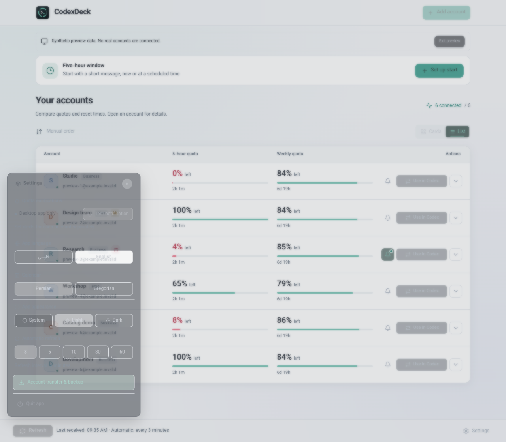
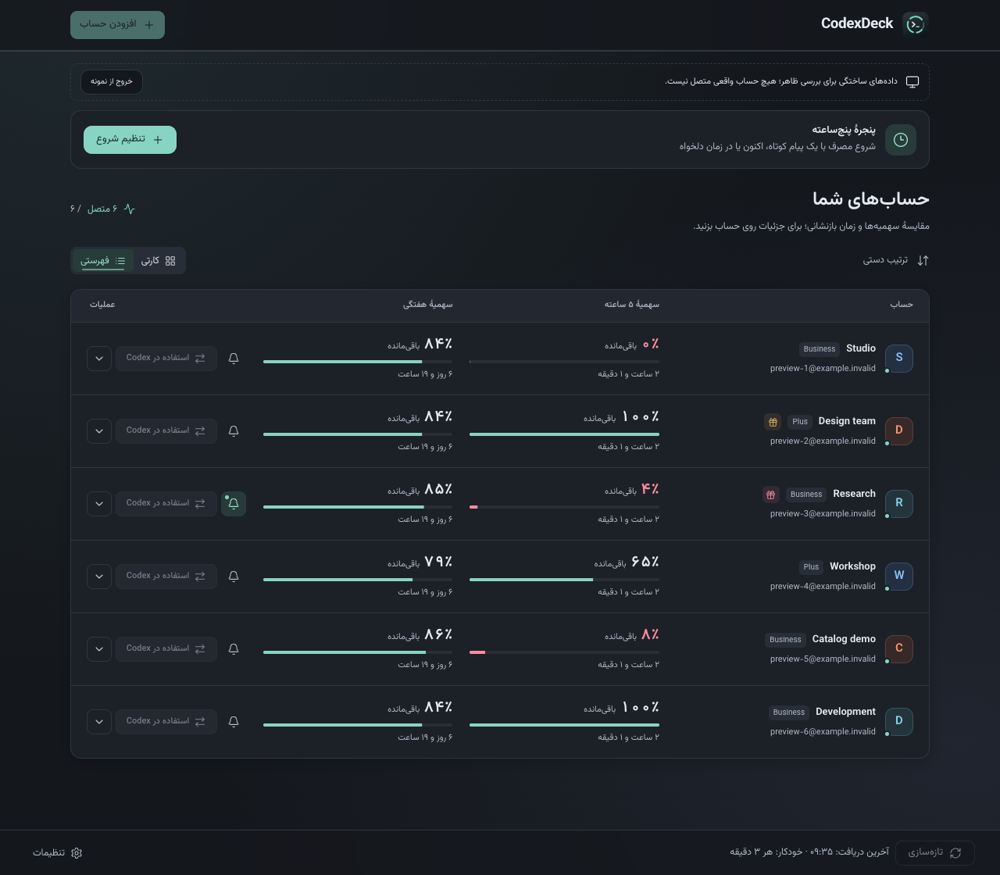

# CodexDeck

A desktop app for monitoring usage across multiple Codex accounts. Built with Tauri, React and Rust.

- Five-hour and weekly quotas, reset countdowns and quota alerts.
- Isolated account sign-in, encrypted account transfer and a menu bar panel.
- Persian and English, light/dark themes and Persian/Gregorian calendars.
- Original Codex/ChatGPT account switching in the signed macOS build.

macOS on Apple Silicon is the locally validated build. Intel macOS, Windows and Linux runtime support remains unverified.

## Preview





The screenshots show synthetic accounts, with no real sign-in data.

## Downloads

Official downloads belong in [GitHub Releases](https://github.com/WorldWideHerd/CodexDeck/releases). A notarized public release has not yet been validated. CI artifacts ending in `-preview.zip` use local development signatures. Each macOS archive includes a matching `.sha256` checksum and `.json` manifest.

For a published macOS release, verify the checksum, extract the ZIP and move `CodexDeck.app` to Applications. See the [release guide](docs/releasing.md) for packaging, Apple signing, GitHub setup and installation checks.

## Run from source

Requires Node.js 22.12+, stable Rust, the [Tauri prerequisites](https://v2.tauri.app/start/prerequisites/) and an installed Codex CLI. macOS also requires Xcode and Python 3.

```sh
npm ci
npm run tauri -- dev
```

Select the Codex executable in Settings if it is not found automatically. `npm run dev` opens a browser preview with optional sample accounts; account operations require the desktop app.

## Build

```sh
npm run build:mac        # signed macOS app: output/CodexDeck.app
npm run package:mac      # preview ZIP, checksum and manifest: output/releases/
npm run tauri -- build   # native packaging on the current platform
```

The macOS script uses a persistent local development signing identity by default. It does not produce a notarized release.

[Development and checks](docs/development.md) · [Release guide](docs/releasing.md) · [Changelog](CHANGELOG.md) · [Account transfer](docs/account-transfer.md) · [Architecture](docs/architecture.md) · [Contributing](CONTRIBUTING.md) · [Security](SECURITY.md) · [Privacy](PRIVACY.md)

## License

[MIT](LICENSE). Bundled components retain their own notices: [shadcn/ui](public/licenses/shadcn-MIT.txt) and [Vazirmatn](public/fonts/OFL.txt).
